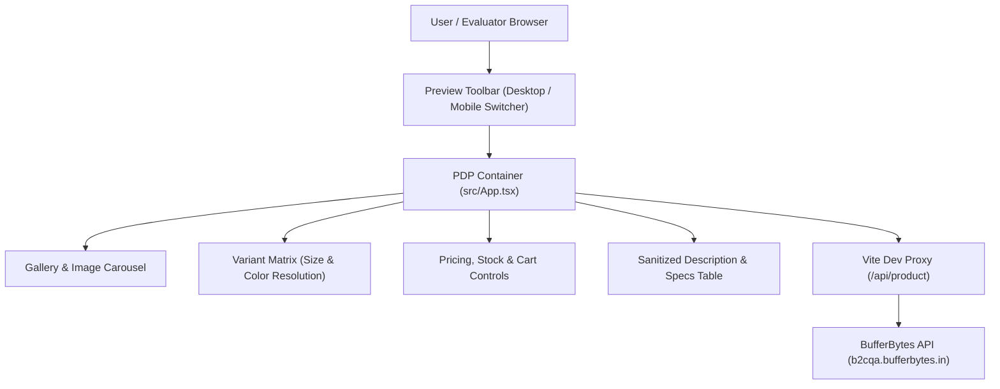

<p align="center">
  
</p>
<h1 align="center">
  Product Detail Page (PDP)
</h1>


<h3 align="center"><em>High-Performance, Responsive E-Commerce Product Experience</em></h3>
<p align="center">
  <a href="https://vite.dev/"></a>
  <a href="https://react.dev/"></a>
  <a href="https://www.typescriptlang.org/"></a>
  <a href="https://tailwindcss.com/"></a>
  <a href="https://lucide.dev/"></a>
  <a href="https://oxc-project.github.io/"></a>
</p>

<h3 align="center">
  <strong>Local URL:</strong> <a href="http://localhost:5173">http://localhost:5173</a>
</h3>

<p align="center">
  <strong>Product Detail Page (PDP)</strong> is an enterprise-grade, high-fidelity e-commerce product interface engineered with <strong>React 19</strong>, <strong>TypeScript</strong>, <strong>Vite</strong>, and <strong>Tailwind CSS 4</strong>. It integrates live dynamic REST API data, featuring a synchronized multi-variant matrix (Color & Size), interactive multi-angle image gallery with touch/swipe controls, live inventory states, real-time desktop/mobile layout toggle, and defensive error boundaries.
</p>

<hr />

## 📋 Table of Contents

- [🎯 Reference & Scope](#-reference--scope)
- [✨ Core Features](#-core-features)
- [🎨 Visual & Interaction Fidelity](#-visual--interaction-fidelity)
- [🏗️ Architecture & Component Design](#️-architecture--component-design)
- [🧰 Tech Stack](#-tech-stack)
- [🤖 AI Workflow & Verification Suite](#-ai-workflow--verification-suite)
- [📁 Project Structure](#-project-structure)
- [🚀 Local Development](#-local-development)
- [📦 Production Build & Quality Gates](#-production-build--quality-gates)
- [🌐 API & Proxy Integration](#-api--proxy-integration)
- [💡 Important Implementation Decisions](#-important-implementation-decisions)
- [👨‍💻 Author](#-author)

---

## 🎯 Reference & Scope

This project implements the comprehensive technical specification outlined in the **Shopify Application / E-Commerce Product Detail Page Coding Exercise**. The application delivers a pixel-perfect, accessible, and high-performance product view backed by live backend catalog data:

1. **Dynamic Catalog Integration:** Consumes real-time product data via secure reverse-proxy with custom vendor authorization (`x-vendor-id`).
2. **Multi-Axis Variant Engine:** Dynamic size and color combination resolution matching API variant availability, prices, SKUs, and stock counts.
3. **Responsive Viewport Switcher:** Built-in preview control bar enabling instant toggle between **Desktop View** and **Mobile View (375px)** for streamlined testing and evaluation.

---

## ✨ Core Features

### 🛍️ Product Presentation & Gallery
- **Multi-Angle Gallery:** Interactive primary image viewport paired with a dynamic thumbnail strip and directional navigation arrows.
- **Image Fallback Resilience:** Graceful broken-image detection (`ImageOff`) displaying elegant placeholder fallbacks without layout shifts.
- **Badge Indicators:** Real-time discount percentage computation and dynamic tags (e.g., Sale, New Arrival).

### ⚙️ Multi-Variant Selection Matrix
- **Color & Size Swatches:** Context-aware selection options dynamically extracted from variant attributes.
- **Availability & Stock Mapping:** Validates exact variant combinations against actual inventory, preventing impossible selections.
- **Real-Time Price Updates:** Dynamically renders regular price, discounted price, and currency formatting reflecting the selected variant.
- **Stock Guardrails:** Dynamic "In Stock" vs. "Out of Stock" status banners with instant purchase button disabling when inventory is zero.

### 🛒 Purchase & Quantity Controls
- **Interactive Stepper:** Increment and decrement controls strictly enforcing minimum quantity bounds (`qty >= 1`).
- **Cart Feedback State:** Visual toast/modal feedback simulating checkout submission with variant details, quantity, and subtotal.
- **Trust & Assurance Badges:** Integrated value propositions including Free Shipping, Secure Payment, and Easy Returns guarantees.

### 📑 Specifications & Rich Content
- **Sanitized HTML Rendering:** Safely converts formatted HTML product descriptions into readable typography.
- **Dynamic Attribute Table:** Automatic rendering of technical specifications, filtering out null or empty parameters.

---

## 🎨 Visual & Interaction Fidelity

The application adheres to clean, modern e-commerce design principles:
- **Curated Palette:** Neutral stone tones (`#1C1917`, `#F5F5F4`), crisp pure white surfaces, and contrasting high-visibility accent tones.
- **Typography:** Refined sans-serif typography with high contrast ratios for effortless legibility.
- **Micro-Interactions:** Smooth border transitions, subtle hover elevations, active ring outlines for accessibility, and animated loading spinners (`LoaderCircle`).
- **Responsive Viewport Controls:** Sticky top preview bar supporting real-time toggling between responsive desktop layout and mobile frame (375px width).

---

## 🏗️ Architecture & Component Design



### Component Structure (`src/App.tsx`)
- **API & Type Helpers:** Strict TypeScript interfaces defining `Product`, `ProductVariant`, `VariantAttribute`, `Image`, and `Specification`.
- **Product Fetching & Retry:** Resilient `fetch` pipeline incorporating vendor auth headers, loading indicators, error boundaries, and one-click retry triggers.
- **Gallery Engine:** State-driven active image index, thumbnail synchronization, and keyboard/touch navigation.
- **Variant Selector:** Bi-directional state matching ensuring size and color selections resolve to existing API variant models.

---

## 🧰 Tech Stack

### Frontend & Build
- **Build Tool:** Vite 8 (Ultra-fast HMR)
- **Framework / UI Library:** React 19
- **Language:** TypeScript 7 (Strict Mode)
- **Styling:** Tailwind CSS 4 (via `@tailwindcss/vite`)
- **Icons:** Lucide React
- **Linter & Static Analysis:** Oxlint

---

## 🤖 AI Workflow & Verification Suite

This application was engineered with a disciplined automated quality assurance lifecycle:

### Quality Assurance Verification
- **Automated Type Checking:** `npx tsc -b` passes with **0** errors.
- **Static Code Analysis:** `npx oxlint` enforces clean code standards across all modules.
- **Production Compilation:** `npm run build` compiles clean production chunks with gzip compression.
- **Viewport Testing:** Validated on standard mobile viewports (375px) and high-resolution desktop viewports.

---

## 📁 Project Structure

```text
PRODUCT DETAIL PAGE/
├── public/
│   ├── favicon.svg                      # Browser Favicon
│   └── icons.svg                        # Brand Vector Assets
├── src/
│   ├── assets/                          # Static Graphics & SVGs
│   ├── App.css                          # App-level Styles
│   ├── App.tsx                          # Core Application & PDP Architecture
│   ├── index.css                        # Tailwind CSS Directives & Design Tokens
│   └── main.tsx                         # React 19 Root Entry
├── product_detail_page_coding_exercise_updated.pdf # Assessment Specification
├── index.html                           # HTML5 Template
├── package.json                         # Dependencies & Scripts
├── package-lock.json                    # Locked Dependency Tree
├── tsconfig.json                        # Root TypeScript Configuration
├── tsconfig.app.json                    # Application TypeScript Rules
├── tsconfig.node.json                   # Node Tooling TypeScript Rules
├── vite.config.ts                       # Vite Configuration & Reverse Proxy
└── README.md                            # Project Documentation
```

---

## 🚀 Local Development

### 1. Prerequisites
- **Node.js:** v18.0.0 or higher (v20+ recommended)
- **npm:** v9.0.0 or higher

### 2. Install Dependencies
Open a terminal in the project root:
```bash
npm install
```

### 3. Launch Development Server
```bash
npm run dev
```

Open [http://localhost:5173](http://localhost:5173) in your browser.

---

## 📦 Production Build & Quality Gates

Run the automated verification suite before submitting or deploying:

```bash
# 1. Type Check
npx tsc -b

# 2. Lint Check
npm run lint

# 3. Production Build
npm run build

# 4. Preview Production Build Locally
npm run preview
```

---

## 🌐 API & Proxy Integration

The application integrates with the supplied live API endpoint:

- **Endpoint:** `/customer/products/59bbc2b3-0ce0-45b6-91d6-efd1ecbb012f/`
- **Host:** `https://b2cqa.bufferbytes.in`
- **Vendor Header:** `x-vendor-id: a9e3d24d-a2fe-4fbb-830f-91e0fee9f299`

### Development Proxy (`vite.config.ts`)
To prevent CORS (Cross-Origin Resource Sharing) restrictions during local development, Vite proxies requests from `/api/product` directly to the target host:

```typescript
server: {
  proxy: {
    "/api/product": {
      target: "https://b2cqa.bufferbytes.in",
      changeOrigin: true,
      secure: true,
      rewrite: () => "/customer/products/59bbc2b3-0ce0-45b6-91d6-efd1ecbb012f/",
    },
  },
}
```

---

## 💡 Important Implementation Decisions

- **Dynamic Data Integrity:** Product name, pricing, SKU, gallery images, variants, stock levels, and specifications are derived dynamically from the API rather than hardcoded.
- **Accurate Variant Resolution:** Variant selection reflects real size/color combinations returned by the backend; invalid permutations are prevented.
- **Authentic Inventory Handling:** Stock values reflect actual API responses. If a variant indicates `stock: 0`, the UI accurately reflects **Out of Stock** and disables purchases.
- **Specification Hygiene:** Specifications with empty values are filtered out automatically, presenting only clean, verified product specifications.

---

## 👨‍💻 Author

**Hashmil Muhammed**  
*Full-Stack Engineer & Technical Assessment Candidate*
